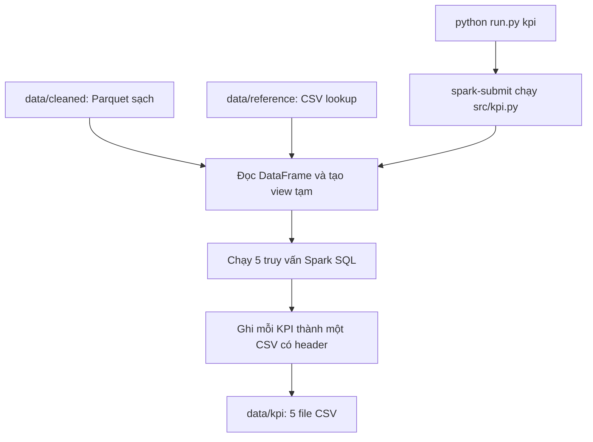

# TLC — Spark và HDFS

## 1. Cài đặt

- Cài Docker Desktop và mở ứng dụng trước khi chạy dự án.
- Cài Python 3 và bảo đảm dùng được lệnh `python`.
- Các lệnh bên dưới dùng Git Bash trên Windows. Có thể dùng PowerShell; riêng lệnh có `MSYS_NO_PATHCONV=1` thì bỏ tiền tố này.
- Không cần cài Spark, Hadoop hoặc PySpark trên máy cá nhân; các thành phần này chạy trong Docker.

Kiểm tra các công cụ:

```bash
python --version
docker --version
docker compose version
```

Đặt file `yellow_tripdata_2023-01.parquet` vào `data/raw/`.

## 2. Hướng dẫn chạy

Mở terminal tại thư mục gốc dự án, nơi chứa `run.py` và `docker-compose.yml`.

**Bước 1: Khởi động Spark và HDFS**

```bash
docker compose up -d
docker compose ps
```

**Bước 2: Nạp dữ liệu gốc lên HDFS**

```bash
MSYS_NO_PATHCONV=1 docker exec namenode bash /scripts/ingest_parquet.sh /local-data/raw/yellow_tripdata_2023-01.parquet /user/tlc/raw
```

Nếu dùng file khác, thay tên file trong lệnh trên.

**Bước 3: Kiểm tra kết nối và chạy làm sạch**

```bash
python run.py test
python run.py
```

Chạy từng lệnh và chờ hoàn tất. Khi làm sạch thành công, terminal hiện `XỬ LÝ HOÀN TẤT`.

**Bước 4: Kiểm chứng lại kết quả**

```bash
python run.py verify
```

Xem danh sách dữ liệu sạch và báo cáo mới nhất:

```bash
MSYS_NO_PATHCONV=1 docker exec namenode hdfs dfs -ls /user/tlc/cleaned/
MSYS_NO_PATHCONV=1 docker exec namenode hdfs dfs -cat '/user/tlc/reports/latest/part-*'
```

Parquet đầu ra nằm trong `data/cleaned/` trên máy cá nhân, đồng thời có một bản
trên HDFS tại `/user/tlc/cleaned/`. Mỗi lần chạy làm sạch sẽ ghi đè cả hai bản.
Spark Master và Worker cùng gắn thư mục `data/` vào `/data` để ghi/đọc các file này.
Sau khi cập nhật cấu hình Docker, chạy lại `docker compose up -d` trước khi xử lý.

**Bước 5: Chạy phân tích Phase 3**

Đặt `taxi_zone_lookup.csv` vào `data/reference/`, rồi chạy sau Phase 2:

```bash
python run.py kpi
```

5 file CSV được ghi trực tiếp vào `data/kpi/`, ghi đè khi chạy lại:

- `revenue_by_hour.csv`: tổng doanh thu (`total_amount`) theo giờ đón khách.
- `top_10_pickup_zones.csv`: 10 mã vùng đón nhiều chuyến nhất, kèm tên quận và vùng.
- `tip_rate_by_payment.csv`: tỷ lệ tip = tổng tip / tổng tiền cước (`fare_amount`) × 100%.
- `weekday_vs_weekend.csv`: số chuyến, doanh thu, quãng đường; thêm trung bình mỗi ngày để so sánh.
- `avg_distance_by_zone.csv`: quãng đường trung bình theo mã vùng, kèm tên quận và vùng.

Tiền tính bằng USD, quãng đường bằng mile. Trung bình mỗi ngày dùng số ngày có
chuyến trong dữ liệu. Tỷ lệ tip chỉ phản ánh tiền tip được ghi trong dữ liệu.

**Dừng hệ thống**

```bash
docker compose down
```

Giao diện theo dõi: [HDFS NameNode](http://localhost:9870) · [Spark Master](http://localhost:8080).

## 3. Cấu trúc thư mục

```text
TLC/
├── config/                     # Cấu hình Hadoop/HDFS
│   ├── core-site.xml           # Địa chỉ HDFS mặc định
│   └── hdfs-site.xml           # Thư mục lưu trữ và số bản sao dữ liệu
├── data/
│   ├── raw/                    # File Parquet gốc trên máy cá nhân
│   ├── cleaned/                # Parquet đã làm sạch, sẵn sàng cho Phase 3
│   ├── reference/              # Bảng tra cứu taxi_zone_lookup.csv tải thủ công
│   └── kpi/                    # 5 kết quả CSV của Phase 3
├── scripts/
│   └── ingest_parquet.sh       # Tải dữ liệu gốc lên HDFS
├── src/
│   ├── clean.py                # Làm sạch, chuẩn hóa và ghi dữ liệu cùng báo cáo
│   ├── test.py                 # Kiểm tra Spark đọc được dữ liệu gốc trên HDFS
│   ├── verify.py               # Kiểm chứng dữ liệu sạch đã ghi
│   └── kpi.py                  # Tính 5 KPI và ghi kết quả CSV
├── tests/
│   └── test_clean.py           # Kiểm thử code bằng dữ liệu mẫu có các trường hợp lỗi
├── run.py                      # Gọi các tác vụ clean/test/verify/kpi trong Docker
├── docker-compose.yml         # Khởi tạo NameNode, DataNode, Spark Master và Worker
└── README.md                   # Hướng dẫn sử dụng dự án
```

Dữ liệu trong HDFS được lưu riêng với thư mục trên máy cá nhân:

```text
/user/tlc/raw/                  # Dữ liệu gốc đã tải lên
/user/tlc/cleaned/              # Dữ liệu Parquet sau khi làm sạch
/user/tlc/reports/              # Báo cáo của từng lần chạy
/user/tlc/reports/latest/       # Báo cáo mới nhất
```

## 4. Bàn giao Phase 2 → Phase 3

- `src/clean.py`: làm sạch dữ liệu, tạo Parquet và báo cáo chất lượng.
- `data/cleaned/`: dữ liệu Parquet đã làm sạch; Phase 3 dùng dữ liệu này.
- `src/verify.py`: kiểm tra dữ liệu đầu ra của Phase 2.
- `run.py`: chạy các tác vụ `test`, `clean`, `verify` và `kpi`.
- `src/kpi.py`: dùng Spark SQL và bảng vùng để tính 5 KPI; ghi kết quả vào `data/kpi/`.
- `data/reference/taxi_zone_lookup.csv`: bảng tra `LocationID` sang tên vùng; tải thủ công trước khi chạy Phase 3.

## 5. Phase 3: Phân tích và khai thác

### 5.1. Cách làm

`src/kpi.py` đọc Parquet sạch của Phase 2 thành DataFrame `trips` và đọc bảng
vùng thành DataFrame `zones`. Hai DataFrame được đăng ký thành view tạm để chạy Spark SQL:

```python
trips.createOrReplaceTempView("clean_trips")
zones.createOrReplaceTempView("taxi_zones")
```

`createOrReplaceTempView()` tạo view tạm trong phiên Spark, phục vụ cùng mục đích
với `CREATE TEMPORARY VIEW`. Các câu SQL được lưu trong `QUERIES` và chạy bằng `spark.sql()`.

| KPI | Cách tính |
|---|---|
| Doanh thu theo giờ | `GROUP BY pickup_hour`, `SUM(total_amount)`, sắp xếp giờ tăng dần |
| Top 10 vùng đón khách | Đếm chuyến theo mã vùng, `ORDER BY trip_count DESC`, `LIMIT 10` |
| Tỷ lệ tip theo thanh toán | `GROUP BY payment_type`, tính `100 × SUM(tip_amount) / SUM(fare_amount)` |
| Ngày thường và cuối tuần | Nhóm theo `is_weekend`; đếm chuyến, cộng doanh thu, tính quãng đường trung bình và trung bình mỗi ngày |
| Quãng đường trung bình theo vùng | `AVG(trip_distance)` theo mã vùng, sắp xếp quãng đường trung bình giảm dần |

Hai KPI theo vùng dùng `LEFT JOIN` với điều kiện `PULocationID = LocationID`.
Kết quả có `pickup_location_id` (mã vùng), `borough` (tên quận) và `pickup_zone`
(tên vùng). Nhóm theo mã vùng cùng tên quận/vùng để giữ riêng các vùng trùng tên.
Chuyến không khớp lookup vẫn được giữ, với tên `Unknown`.

Chương trình kiểm tra `LocationID` trùng trong lookup trước khi join để tránh đếm dư.
Tiền được chuyển sang `DECIMAL(20, 2)` trước khi cộng; tỷ lệ tip và quãng đường
trung bình làm tròn 4 chữ số thập phân. Nếu tổng tiền cước bằng 0, tỷ lệ tip để trống.
Cuối tuần là thứ Bảy và Chủ nhật, theo cột `is_weekend` do Phase 2 tạo.

### 5.2. Hướng dẫn chạy riêng Phase 3

Mở terminal tại thư mục gốc dự án. Cần có:

- Các file Parquet trong `data/cleaned/` từ Phase 2, giữ nguyên cấu trúc thư mục phân vùng.
- File `data/reference/taxi_zone_lookup.csv`, chứa các cột `LocationID`, `Borough`, `Zone`.

```bash
docker compose up -d
python run.py kpi
```

Nếu chưa có dữ liệu sạch, chạy `python run.py clean` trước lệnh KPI.
Phase 3 dùng file lookup có sẵn, không tự tải từ Internet.
Khi thành công, terminal hiện `Phase 3 hoàn tất. CSV KPI:` và đường dẫn 5 file.

Kiểm tra file đầu ra trong Git Bash:

```bash
ls data/kpi/*.csv
head -n 5 data/kpi/top_10_pickup_zones.csv
```

### 5.3. Cấu trúc source Phase 3

| Thành phần | Chức năng |
|---|---|
| `run.py` | Nhận tác vụ `kpi`, gọi `spark-submit` trong container `spark-master` |
| `src/kpi.py` — `INPUT`, `ZONE_LOOKUP`, `OUTPUT` | Khai báo đường dẫn Parquet sạch, bảng vùng và kết quả CSV |
| `src/kpi.py` — `QUERIES` | Chứa 5 câu SQL tính KPI |
| `src/kpi.py` — `run()` | Đọc dữ liệu, kiểm tra lookup, tạo view, chạy SQL và xuất 5 CSV |
| `src/kpi.py` — `main()` | Tạo phiên Spark, gọi `run()`, đóng phiên và thông báo hoàn tất |
| `docker-compose.yml` | Gắn `src/` vào Spark Master và `data/` vào cả Spark Master/Worker |

Các đường dẫn `file:///data/...` chỉ file trên thư mục được mount từ máy cá nhân.
Tiền tố `file:///` giúp Spark đọc/ghi đúng thư mục này thay vì dùng HDFS mặc định.

### 5.4. Luồng hoạt động



Với mỗi KPI, `coalesce(1)` gom kết quả tổng hợp để Spark ghi một part-file trong
thư mục tạm. Chương trình đổi tên part-file thành tên KPI, chuyển vào `data/kpi/`
và dọn thư mục tạm. Chạy lại sẽ thay thế CSV tương ứng; các đầu ra chỉ được cập nhật
hết khi cả 5 truy vấn hoàn tất.
