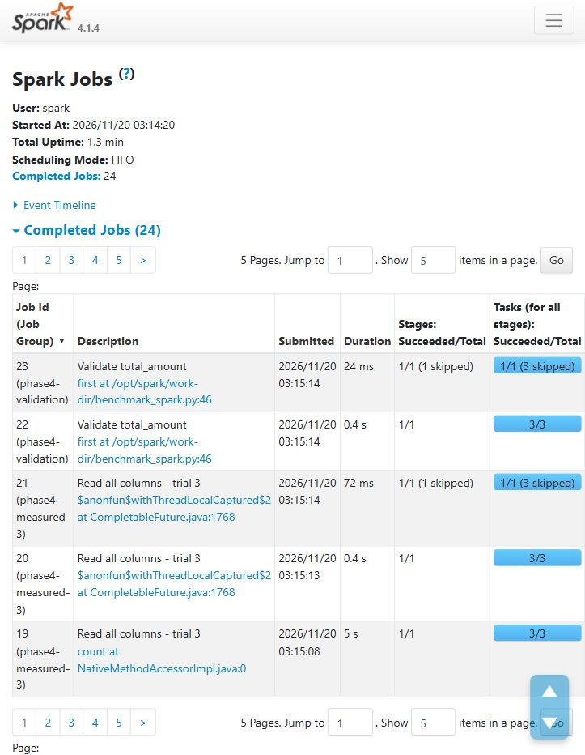
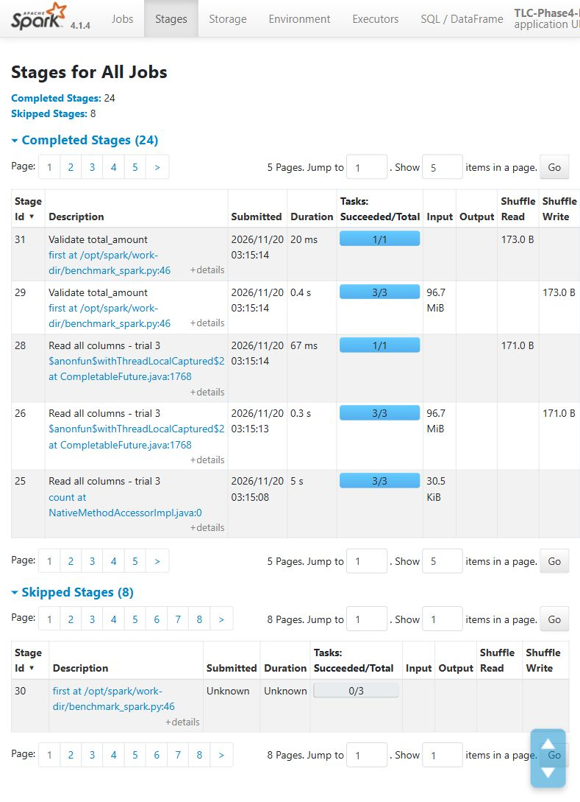
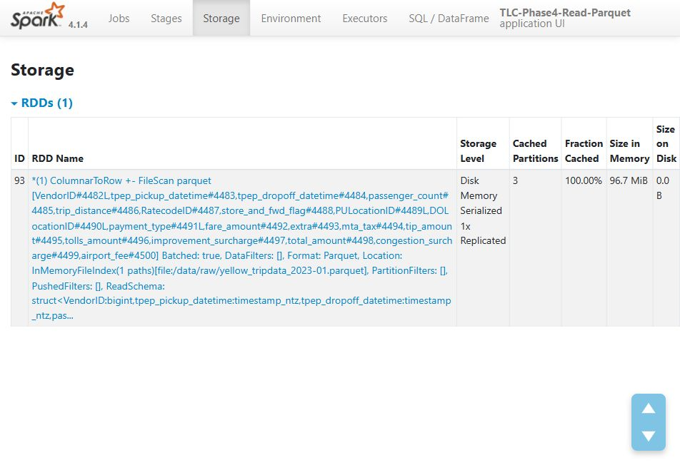

# Phase 4 — Đo thời gian đọc Parquet

File `data/raw/yellow_tripdata_2023-01.parquet`, 47,673,370 byte.
Hai engine khớp 3,066,766 dòng, 19 cột và tổng `total_amount` 82865192.22.

| Engine | Lần đo | Trung bình (s) | Trung vị (s) | Nhỏ nhất (s) | Lớn nhất (s) |
|---|---|---|---|---|---|
| Pandas | 3 | 0.7524 | 0.7054 | 0.6477 | 0.9041 |
| Spark | 3 | 6.6181 | 6.5140 | 6.0188 | 7.3214 |

Pandas nhanh hơn Spark 9.23 lần theo trung vị.
Tỷ số Pandas/Spark theo trung vị = 0.1083. Lớn hơn 1 nghĩa là Spark nhanh hơn.
Khởi tạo SparkSession mất 14.2888s, được ghi riêng.

## Cách đo

1. Pandas đọc đủ cột bằng `read_parquet`, rồi đếm số dòng.
2. Spark đọc cùng file, dùng `persist` và `count` để nạp đủ cột, rồi đếm dòng.
3. Mỗi công cụ chạy thử một lần, đo 3 lần và đối chiếu kết quả.

Spark có 3 partition và hoàn tất 8 task trong lần đo cuối.
Phiên đo là `app-20261120031424-0001`.

Phép đo gồm chi phí cache của Spark. Thời gian cài thư viện, import và khởi tạo
tiến trình/SparkSession được loại khỏi khoảng đo. Chạy Pandas trước Spark,
cache hệ điều hành được giữ sau lần làm nóng. Pandas chạy trên Worker,
Spark dùng thêm Driver trên Master. Kết quả áp dụng cho file và cấu hình này.

`benchmark_runs.csv` lưu từng lần đo. `environment.json` lưu cấu hình và mã kiểm tra file.
Các file JSON còn lại lưu số liệu gốc. Ba ảnh bên dưới chụp từ Spark UI.

